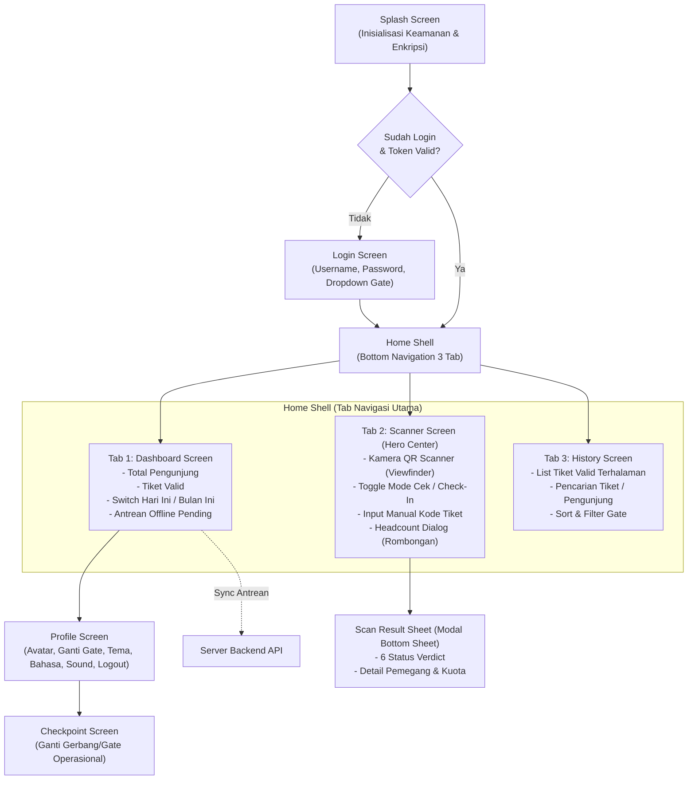

# Rekapan Lengkap Fitur & Arsitektur Mobile Tix (Untuk Panduan Redesign)

Dokumen ini memuat inventarisasi menyeluruh seluruh fitur, layar (*screens*), komponen UI, alur navigasi, logika bisnis, serta integrasi sistem pada aplikasi **Mobile Tix** (`mobile-tix`). Dokumen ini disusun sebagai acuan utama dalam proses **redesign** antarmuka (UI/UX) dan restrukturisasi aplikasi.

---

## 1. Ringkasan Eksekutif & Profil Aplikasi

- **Nama Aplikasi**: Mobile Tix (Mobile Ticket Validator)
- **Tujuan Utama**: Membantu petugas gerbang (*gate officers*) memvalidasi dan mencatat kehadiran (*check-in*) pengunjung konser/event secara cepat, akurat, dan tangguh di lapangan (bahkan saat koneksi internet lemah atau terputus).
- **Pengguna Target**: Petugas lapangan / gate crew (menggunakan perangkat mobile Android/iOS, sering memegang scanner dengan satu tangan di kondisi pencahayaan dinamis/ramai).
- **Prinsip Operasional**: *Offline-First*, *Single-Tap Workflow*, *Haptic & Sound Feedback*, *High Visibility*.

---

## 2. Peta Alur Aplikasi (*Screen & Navigation Flow*)



---

## 3. Rincian Seluruh Layar (*Screens*) & Komponen UI

### 3.1. Splash Screen ([`splash_screen.dart`](lib/features/auth/presentation/screens/splash_screen.dart))
- **Fungsi**: Memuat konfigurasi awal, mengecek integritas Hive local storage, inisialisasi AES-256 encryption, dan validasi sesi JWT petugas.
- **Elemen UI**:
  - Logo aplikasi animasi halus (*fade-in*).
  - Indikator loading minimalis.
  - Nama dan versi aplikasi di bagian bawah.

---

### 3.2. Login Screen ([`login_screen.dart`](lib/features/auth/presentation/screens/login_screen.dart))
- **Fungsi**: Autentikasi petugas gerbang dan pemilihan lokasi gerbang (*checkpoint/gate*) awal sebelum masuk sistem.
- **Elemen UI**:
  - **Logo & Judul**: Brand lockup "Gate Validator".
  - **Input Username**: Field teks dengan ikon pengguna (*user icon*).
  - **Input Password**: Field password dengan tombol toggle intip password (*obscure/reveal*).
  - **Dropdown Gerbang (Gate Selector)**:
    - Dropdown daftar gate yang aktif dari API (`/checkpoints`).
    - Penanganan jika gagal/offline: teks penjelas dan tombol inline **"Coba lagi"**.
  - **Tombol Login**: Tombol utama berkontras tinggi (*primary button*) dengan *loading indicator* saat proses autentikasi.

---

### 3.3. Home Shell & Bottom Navigation ([`home_shell.dart`](lib/routes/home_shell.dart))
- **Fungsi**: Kontainer utama yang menampung 3 layar fitur dengan `IndexedStack` (agar state dan kamera tidak hilang saat berpindah tab).
- **Elemen UI**:
  - **Tab 1 (Kiri)**: Ikon Dashboard + Label "Dashboard".
  - **Tab 2 (Tengah - Hero)**: Tombol Scan mengambang (*Hero circular button*) dengan kontras warna tegas dan efek shadow halus untuk akses cepat satu jari.
  - **Tab 3 (Kanan)**: Ikon Riwayat + Label "Riwayat" / "History".
  - **Auto-Sync Listener**: Setiap pemindaian sukses di tab Scanner otomatis memicu pembaruan data (*refresh*) di Dashboard dan History secara instan.

---

### 3.4. Tab 1: Dashboard Screen ([`dashboard_screen.dart`](lib/features/dashboard/presentation/screens/dashboard_screen.dart))
- **Fungsi**: Memberikan ringkasan angka performa gerbang hari ini / bulan ini serta mengelola antrean scan yang tertunda saat offline.
- **Elemen UI**:
  1. **Top Header**:
     - Avatar inisial petugas (mis. "RA" untuk Raya). Mengetuk avatar membuka **Profile Screen**.
     - Pill Status Koneksi (`ConnectionPill`): Indikator hijau "Online" / abu-abu "Offline". Dapat diketuk untuk tes sinyal paksa.
  2. **Greeting Section**: Ucapan selamat datang dinamis ("Selamat siang", nama petugas, dan nama gerbang yang sedang dijaga).
  3. **Period Switcher**: Segmented toggle antara **"Hari Ini"** dan **"Bulan Ini"**.
  4. **Ringkasan Kartu Metrik**:
     - **Card Pengunjung (Total Visitors)**: Kartu putih bersih dengan angka besar dan ikon rombongan/orang.
     - **Card Valid**: Kartu status sukses berwarna/beraksen hijau menampilkan total tiket valid yang telah masuk.
     *(Catatan: Kartu ditolak telah disembunyikan sesuai permintaan privasi operasional sebelumnya)*.
  5. **Pending Offline Queue Section** (Muncul jika ada antrean tersimpan):
     - Banner peringatan antrean offline.
     - Daftar tiket yang belum terkirim ke server beserta tombol kirim manual per-tiket atau tombol sinkronisasi massal (*Sync All*).
  6. **Pull-to-Refresh**: Swipe ke bawah untuk menyegarkan angka dari server.
  7. **Shimmer Skeleton Loading**: Efek animasi kerangka saat metrik sedang diunduh.

---

### 3.5. Tab 2: Scanner Screen ([`scanner_screen.dart`](lib/features/scanner/presentation/screens/scanner_screen.dart))
- **Fungsi**: Pusat operasional pemindaian barcode / QR Code tiket secara real-time via kamera maupun input kode manual.
- **Elemen UI & Fitur**:
  1. **Camera Viewfinder**:
     - Menggunakan `mobile_scanner` dengan rasio optimal di bagian atas layar.
     - Overlay garis panduan scan (bingkai reticle/target) dan animasi laser scanner.
     - Tombol Flash / Lampu Senter (on/off).
  2. **Mode Switcher (Pilihan Mode Kerja)**:
     - **Mode Check-In**: Memverifikasi tiket sekaligus memproses check-in (mengurangi kuota / menandai tiket digunakan di database).
     - **Mode Cek (Verifikasi Saja)**: Hanya mengintip status dan data tiket tanpa mengubah status tiket di database.
  3. **Input Manual Toggle**:
     - Tombol untuk memunculkan keyboard dan kolom teks bila kode QR fisik kotor/rusak.
  4. **Pita Demo / Walkthrough Sample Codes**:
     - Chip contoh tiket untuk simulasi offline & pengujian berbagai status tiket.
  5. **Proteksi Cooldown**: Proteksi debounce 2 detik agar kode yang sama tidak terpindai berulang kali secara tidak sengaja.

---

### 3.6. Dialog & Bottom Sheet Scanner

#### A. Headcount Dialog / Validasi Kuota Riil ([`group_headcount_dialog.dart`](lib/features/scanner/presentation/widgets/group_headcount_dialog.dart))
- **Fungsi**: Memvalidasi jumlah orang yang benar-benar datang untuk tiket rombongan/kelompok.
- **Elemen UI**:
  - Nama rombongan / pemegang tiket.
  - Kuota maksimal tiket (misal: 10 Orang).
  - Stepper tombol minus (`-`) dan plus (`+`) untuk menyesuaikan jumlah orang yang hadir riil.
  - Peringatan otomatis dan penonaktifan tombol konfirmasi jika jumlah melebihi kuota (*exceeded*).
  - Tombol **"Konfirmasi Masuk (X Orang)"** dan tombol **"Batal"**.

#### B. Scan Result Sheet ([`scan_result_sheet.dart`](lib/features/scanner/presentation/widgets/scan_result_sheet.dart))
- **Fungsi**: Modal bottom sheet yang muncul segera setelah tiket dipindai, menyajikan verdict visual dan audio feedback.
- **6 Status Verdict yang Ditangani**:
  1. **Valid**: Hijau cerah, centang, otomatis tertutup (*auto-dismiss*) dalam 1,8 detik agar petugas bisa langsung scan tiket berikutnya.
  2. **Already Used (Sudah Dipakai)**: Merah oranye, menampilkan info jam scan sebelumnya dan gerbang tempat tiket dipakai.
  3. **Expired (Kadaluarsa)**: Oranye kemerahan, menampilkan batas tanggal berlaku.
  4. **Cancelled (Dibatalkan)**: Merah, peringatan tiket telah dibatalkan panitia.
  5. **Not Found (Tidak Ditemukan)**: Abu-abu merah, kode tidak terdaftar di sistem.
  6. **Server Error / Offline Queued**: Status jaringan / antrean tersimpan.
- **Detail Tambahan di Sheet**:
  - Nomor tiket (dapat disalin / *copyable*).
  - Nama pemilik / kategori (VIP, Reguler, Rombongan).
  - Gate aktif dan waktu pemindaian.

---

### 3.7. Tab 3: History Screen ([`history_screen.dart`](lib/features/history/presentation/screens/history_screen.dart))
- **Fungsi**: Menelusuri seluruh riwayat scan tiket yang berhasil (*valid*) secara terhalaman (*infinite scroll*).
- **Elemen UI**:
  1. **Header Riwayat**: Menampilkan judul dan jumlah total pemindaian (misal: "128 scans").
  2. **Search Bar**: Kotak pencarian interaktif untuk memfilter berdasarkan kode tiket, nama tamu, atau checkpoint.
  3. **Sorting Control**:
     - Mengurutkan berdasarkan: **Terbaru**, **Terlama**, atau **Rombongan Terbanyak**.
  4. **History Row Item** ([`history_row.dart`](lib/features/history/presentation/widgets/history_row.dart)):
     - Kode tiket, nama tamu, checkpoint gerbang, jumlah pengunjung, dan jam scan.
     - Mengetuk item akan menampilkan detail ringkas tiket.
  5. **Empty State**: Tampilan visual saat belum ada scan atau hasil pencarian nihil.

---

### 3.8. Profile Screen ([`profile_screen.dart`](lib/features/auth/presentation/screens/profile_screen.dart))
- **Fungsi**: Pengaturan preferensi personal petugas, perangkat keras scanner, dan pergantian checkpoint gerbang.
- **Elemen UI**:
  1. **Identitas Petugas**: Lingkaran inisial besar, nama lengkap petugas login, dan label peran ("Petugas Gate").
  2. **Pengaturan Tema**: Switch / selector antara mode **Terang (Light)**, **Gelap (Dark)**, dan **Sistem**.
  3. **Pengaturan Bahasa**: Pilihan **Bahasa Indonesia** atau **English**.
  4. **Umpan Balik Scanner (Hardware Feedback)**:
     - **Toggle Suara Beep**: Mengaktifkan/menonaktifkan audio suara beep saat tiket discan.
     - **Toggle Getar Haptic**: Mengaktifkan/menonaktifkan getaran haptic pada smartphone.
  5. **Checkpoint Aktif**: Baris penunjuk gate saat ini dengan aksi untuk membuka modal pergantian gate.
  6. **Uji Koneksi**: Baris status sinyal real-time dengan tombol tes ulang koneksi internet.
  7. **Informasi Versi**: Versi aplikasi dan status build security.
  8. **Tombol Keluar (Sign Out)**: Konfirmasi dialog sebelum menghapus sesi login dan kembali ke layar login.

---

### 3.9. Checkpoint Screen ([`checkpoint_screen.dart`](lib/features/checkpoint/presentation/screens/checkpoint_screen.dart))
- **Fungsi**: Memilih atau berpindah gerbang penugasan secara dinamis tanpa perlu logout.
- **Elemen UI**:
  - Daftar kartu gerbang (*Gate Cards*) dari server/cache lokal.
  - Indikator radio gerbang yang sedang aktif.
  - Catatan deskripsi lokasi/shift tiap gate.

---

## 4. Analisis Masalah Operasional Terkini

Berdasarkan laporan pengujian Anda:

### 1. Masalah: "Kenapa fitur validasi berapa orang yang datang real nya hilang?"
- **Fakta Kode**: Komponen [`group_headcount_dialog.dart`](lib/features/scanner/presentation/widgets/group_headcount_dialog.dart) **tidak pernah dihapus**, fiturnya masih lengkap 100%.
- **Penyebab Tidak Muncul**:
  Di dalam [`scanner_screen.dart`](lib/features/scanner/presentation/screens/scanner_screen.dart#L93), terdapat validasi:
  ```dart
  if (cubit.mode == ScanMode.checkIn && TicketCode.isGroup(trimmed))
  ```
  Di mana `TicketCode.isGroup` mengecek apakah string kode tiket diawali dengan `'GRP'`.
  Pada database/event nyata, kode tiket rombongan sering kali berformat angka atau kode unik acak tanpa awalan `'GRP'`. Akibatnya, aplikasi menganggap tiket tersebut adalah tiket individu biasa sehingga dialog konfirmasi orang tidak dimunculkan dan langsung melakukan check-in.
- **Solusi Redesign / Logic**:
  Cek kuota tiket langsung dari data respons server (`visitorCount > 1`) atau sediakan toggle di layar scanner agar petugas bisa memasukkan jumlah riil kapan pun diperlukan.

### 2. Masalah: "Waktu aku scan tidak ada data masuk di dashboard, tapi di database ada"
- **Penyebab**:
  1. **Mode Scanner**: Jika saat memindai scanner berada pada **"Mode Cek"** (bukan "Mode Check-In"), aplikasi hanya memanggil `/ticket/check`. Status tiket terverifikasi dan tercatat di log database, namun **belum di-check-in**, sehingga angka dashboard (pengunjung hadir) tidak bertambah.
  2. **Agregasi API Dashboard**: Data angka di layar Dashboard berasal dari endpoint backend `/dashboard/summary?period=today`. Jika query backend belum merefresh agregasi *real-time* atau backend memfilter berdasarkan ID checkpoint tertentu yang berbeda, angka dashboard tidak langsung berubah meskipun row scan tersimpan di tabel tiket.
  3. **Status Antrean Offline**: Jika koneksi sempat terganggu mikro (*timeout*), scan otomatis masuk ke antrean lokal (`_PendingQueueSection`) di Dashboard dan memerlukan konfirmasi "Kirim ke Server" sebelum tercatat ke metrik online.

---

## 5. Panduan & Rekomendasi Redesign (UI/UX)

Saat melakukan proses redesign, berikut daftar prioritas dan catatan fungsional yang harus dipertahankan:

| Komponen / Fitur | Rekomendasi Redesign | Catatan Fungsional |
| :--- | :--- | :--- |
| **Scanner Viewfinder** | Maksimalkan area kamera; buat bingkai reticle lebih modern dan elegan. | Tombol Flash dan Switch Mode (Cek vs Check-In) harus mudah dijangkau ibu jari. |
| **Card Dashboard** | Tampilkan angka dengan tipografi tebal (*high-contrast*); tambahkan visual tren sederhana. | Hanya tampilkan metrik Pengunjung & Valid (Ditolak tetap tersembunyi sesuai kebijakan). |
| **Result Modal Sheet** | Buat warna verdict (Hijau/Merah/Oranye) sangat tegas karena petugas sering di tempat redup/terik. | Pertahankan *auto-dismiss* 1,8 detik untuk status Valid agar antrean penonton lancar. |
| **Headcount Input** | Perbesar tombol `+` dan `-` pada stepper dialog rombongan agar mudah ditekan petugas bersarung tangan. | Beri batas maksimal sesuai kuota tiket dan tampilkan total orang dengan jelas. |
| **Status Koneksi** | Letakkan pill sinyal secara konsisten di sudut atas semua layar utama. | Sediakan feedback visual yang jelas saat beralih otomatis ke *Mode Offline*. |
| **Navigasi Bawah** | Pertahankan tombol Scan di posisi tengah mengambang (*Hero Action*). | Tiga tab (Dashboard, Scan, History) adalah kombinasi paling ideal untuk petugas gate. |

---
*Dokumen ini siap dijadikan dasar perancangan wireframe dan desain Figma baru.*
